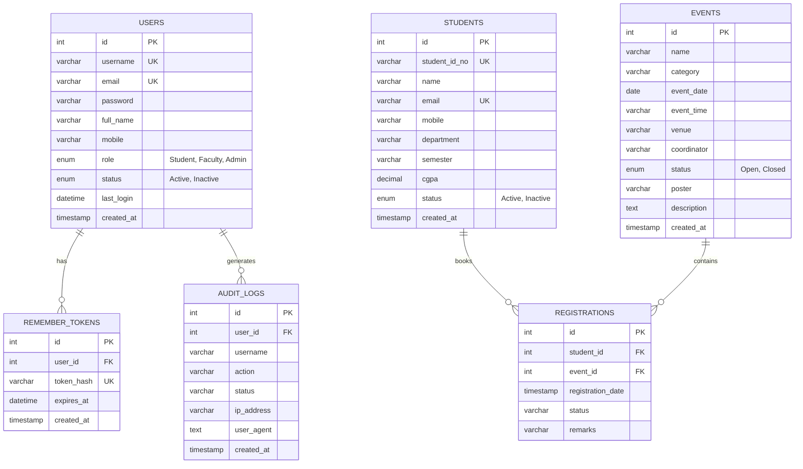

# StudentHub Portal - Practical 15 Final Integration, Testing, Documentation, and Local Deployment

**Author:** Miral Patel  
**Student ID:** 25CE082  
**Department:** Computer Engineering (CE)  
**Institution:** Chandubhai S. Patel Institute of Technology (CSPIT)  
**University:** Charotar University of Science and Technology (CHARUSAT)  
**Course:** Web Development Laboratory (B.Tech 2nd Year, 4th Semester)  
**Target Repository:** `https://github.com/pmiral2103/25ce082-web-devlopment`  
**Target Module:** `p-15/`  

---

## 1. Executive Summary & Problem Definition

**StudentHub** is an enterprise-grade, integrated web portal designed to unify student management, secure role-based access control (RBAC), campus event publication with validated media uploads, and real-time asynchronous search into a single consolidated system.

In **Practical 15**, the objective is to integrate all previously developed independent lab modules (Practicals 1 through 14) into a cohesive, production-ready full-stack application. The project incorporates rigorous server-side PHP processing, MySQL relational data integrity with prepared statements, session security with persistent tokens, dynamic dashboards, and accessibility standards.

### Key Architectural Questions Addressed:
1. **Navigability & Cohesion:** Are all portal sections smoothly connected with role-aware dynamic navigation?
2. **End-to-End Security:** Are authentication, password hashing (`password_hash`), session expiration (30-minute idle timeout), SHA-256 remember-me tokens, and CSRF validations functioning reliably?
3. **Robust Data Operations:** Are relational CRUD queries executing safely via parameterized MySQLi statements without SQL injection vulnerabilities?
4. **Asynchronous User Experience:** Does the live event search operate seamlessly with debounced Fetch API calls and standard HTTP response codes?
5. **Deployment Readiness:** Is the application structured for zero-configuration local deployment under XAMPP and Apache Virtual Hosts?

---

## 2. Integrated Module Matrix (Practicals 1 to 15)

The table below illustrates how each foundational lab requirement has been integrated into the final Practical 15 portal:

| Practical Module | Topic / Focus Area | Key Implementation in `p-15/` | Key Files in `p-15/` |
| :--- | :--- | :--- | :--- |
| **P-1 & P-2** | Semantic HTML5 & CSS3 Styling | High-contrast accessible layout, responsive design, skip links, mobile navbar | `style.css`, all views |
| **P-3 to P-6** | Client-Side JavaScript & Form Validation | Real-time pattern matching, modal dialogs, AJAX event filtering | `events.php`, `login.php`, `register.php` |
| **P-7** | PHP Form Processing & Storage | Server-side sanitization, CSV export streaming, error handling | `export_csv.php`, `register.php` |
| **P-8** | Relational Database & Prepared Statements | Normalized 3NF MySQL schema, foreign key cascades, parameterized queries | `db.php`, `studenthub_complete.sql` |
| **P-9** | Secure Registration & Password Hashing | Duplicate checks, Bcrypt salted hashing (`PASSWORD_BCRYPT`), CSRF protection | `register.php`, `auth_helper.php` |
| **P-10** | Session Authentication & Remember-Me | `password_verify()`, session ID regeneration, 30-day token hashing, 30m timeout | `login.php`, `logout.php`, `auth_helper.php` |
| **P-11** | Student CRUD, Search & Soft Delete | Full student management, search by ID/name/department, soft delete via status | `students.php`, `export_csv.php` |
| **P-12** | Event CRUD & Validated File Uploads | Poster uploads with MIME verification (`image/jpeg`, `png`, `webp`), size <= 2MB | `events.php`, `uploads/.htaccess` |
| **P-13** | RESTful JSON API & Fetch API CRUD | Asynchronous JSON endpoints, debounced real-time event filtering, HTTP status codes | `api/events.php`, `events.php` |
| **P-14** | Admin Dashboard, Analytics & Audit Logs | Aggregate SQL statistics, Chart.js monthly trend chart, user status toggle, audit trail | `dashboard.php`, `toggle_user.php` |
| **P-15** | **Final Integration & Deployment** | **Complete unified portal, health diagnostic setup, virtual host guide, test report** | **All files in `p-15/`** |

---

## 3. Directory Structure

```text
25ce082-web-devlopment/
└── p-15/
    ├── api/
    │   └── events.php              # RESTful JSON API endpoint (GET search, POST create/delete)
    ├── image/
    │   └── charusatlogo.png        # Official institutional branding logo
    ├── uploads/
    │   ├── .htaccess               # Upload directory security (blocks executable script execution)
    │   ├── default_poster.png      # Fallback poster image
    │   └── event_*.jpg             # Uploaded event posters (validated)
    ├── auth_helper.php             # Unified auth session guard, RBAC, CSRF, audit logging
    ├── dashboard.php               # Role-based dashboard (Admin analytics & Student portal)
    ├── db.php                      # Database connectivity configuration
    ├── events.php                  # Event management CRUD, poster upload, AJAX search
    ├── export_csv.php              # Asynchronous CSV streaming endpoint for student records
    ├── index.php                   # Portal landing page with live metrics and event cards
    ├── login.php                   # Secure authentication with Bcrypt and Remember-Me
    ├── logout.php                  # Secure session destruction and token revocation
    ├── README.md                   # Comprehensive project documentation and lab report
    ├── register.php                # Student account creation with validation and hashing
    ├── registrations.php           # Event enrollment module with confirmation codes
    ├── setup.php                   # System health diagnostics and one-click database seeder
    ├── studenthub_complete.sql     # Complete database dump with schema and seed records
    ├── style.css                   # Unified StudentHub stylesheet (Blue palette #1E3A8A)
    └── toggle_user.php             # Admin action handler for user account activation/deactivation
```

---

## 4. Relational Database Schema & Architecture

The database `studenthub_db` follows third normal form (3NF) principles with referential integrity constraints:



---

## 5. Local Deployment Guide (XAMPP Port 8080)

### Prerequisites:
- XAMPP with PHP 8.0+ and MySQL 10.4+
- Port 8080 configured for Apache (default in this environment)
- Port 3306 for MySQL

### Step 1: Clone / Copy Files into Web Root
Copy or symlink the repository `p-15` folder into the XAMPP `htdocs` directory:
```powershell
robocopy "C:\Users\01\25ce082-web-devlopment\p-15" "C:\xampp\htdocs\82-lab\p-15" /E
```

### Step 2: Start Apache and MySQL Services
Ensure Apache and MySQL are running in the XAMPP Control Panel.
- Apache URL: `http://localhost:8080/`
- MySQL Host: `localhost:3306` (User: `root`, Password: ``)

### Step 3: Run One-Click System Setup & Health Check
Open your browser and navigate to:
```text
http://localhost:8080/82-lab/p-15/setup.php
```
Click **"Initialize Missing Tables & Seed"** or **"Reset All Data & Re-seed"**.  
The setup script will:
1. Create `studenthub_db` if it does not already exist.
2. Build all 6 relational tables with primary keys, foreign keys, and indexes.
3. Seed 26 student profiles across CE, IT, CSE, EC, ME departments.
4. Seed 20 campus events with dates, coordinators, and categories.
5. Seed 16 initial event registrations.
6. Seed default user accounts for Admin, Student, and Faculty.

### Step 4: Access the Application
- **Portal Landing Page:** `http://localhost:8080/82-lab/p-15/index.php`
- **Login Page:** `http://localhost:8080/82-lab/p-15/login.php`
- **Student Management:** `http://localhost:8080/82-lab/p-15/students.php`
- **Events Catalog:** `http://localhost:8080/82-lab/p-15/events.php`
- **Registrations:** `http://localhost:8080/82-lab/p-15/registrations.php`
- **RESTful API:** `http://localhost:8080/82-lab/p-15/api/events.php`

---

## 6. Intermediate Extension: Apache Virtual Host Deployment

To run StudentHub under a clean custom domain like `http://studenthub.local:8080/`:

### Step 1: Configure Apache Virtual Hosts (`httpd-vhosts.conf`)
Open `C:\xampp\apache\conf\extra\httpd-vhosts.conf` in an editor and append the following block:

```apache
<VirtualHost *:8080>
    ServerAdmin 25ce082@charusat.edu.in
    DocumentRoot "C:/xampp/htdocs/82-lab/p-15"
    ServerName studenthub.local
    ErrorLog "logs/studenthub-error.log"
    CustomLog "logs/studenthub-access.log" common
    
    <Directory "C:/xampp/htdocs/82-lab/p-15">
        Options Indexes FollowSymLinks
        AllowOverride All
        Require all granted
    </Directory>
</VirtualHost>
```

### Step 2: Ensure Virtual Hosts are Included in `httpd.conf`
Verify that `C:\xampp\apache\conf\httpd.conf` has the following line uncommented:
```apache
Include conf/extra/httpd-vhosts.conf
```

### Step 3: Update Windows Local DNS (`hosts` File)
Open Notepad as Administrator and open `C:\Windows\System32\drivers\etc\hosts`.  
Add the following entry:
```text
127.0.0.1    studenthub.local
```

### Step 4: Restart Apache and Test
Restart Apache via XAMPP Control Panel. Navigate to:
```text
http://studenthub.local:8080/
```
The application will serve directly from the virtual host root!

---

## 7. Advanced Extension: Online / Cloud Deployment Analysis

When transitioning StudentHub from a local LAMP/WAMP environment to an online cloud provider, architectural trade-offs between static frontend hosts and dynamic backend runtimes must be considered:

### Deployment Options:
1. **Full-Stack PHP PaaS (Recommended: Render, Railway, Fly.io, Heroku):**
   - **Mechanism:** Deploys PHP runtime alongside an external managed MySQL database (e.g. PlanetScale, Supabase MySQL, or AWS RDS).
   - **Persistent Media:** Uploaded files (`uploads/`) should be routed to an object storage service such as AWS S3 or Cloudinary rather than the ephemeral server filesystem.
2. **Traditional Cloud / Shared CPanel Hosting (InfinityFree, Hostinger):**
   - Supports native PHP 8.x and phpMyAdmin MySQL databases out of the box.
   - Requires setting database credentials in `db.php` (`$host`, `$username`, `$password`, `$database`).
3. **Frontend Separation on Static Jamstack (Vercel / GitHub Pages):**
   - **Limitation:** Vercel or GitHub Pages can only host the static HTML, CSS, client-side JS, and assets.
   - Because PHP runs on a server engine to evaluate sessions, Bcrypt hashing, and direct MySQL connections, static hosts cannot execute PHP files directly.
   - **Decoupled Architecture Solution:** The frontend can be decoupled into a Single Page Application (React/Vue or vanilla JS) hosted on Vercel, communicating asynchronously via HTTPS with the PHP backend API (`/api/events.php`) hosted on Render or AWS Lambda.

---

## 8. Verification & Automated Test Report

An automated integration test suite (`test_runner.php`) was executed against the local environment (`http://localhost:8080/82-lab/p-15/`) covering 11 critical user workflows:

| Test ID | Test Scenario | Request Method & Endpoint | Expected Outcome | Actual Result | Status |
| :---: | :--- | :--- | :--- | :--- | :---: |
| **TC-01** | Public Landing Page | `GET /index.php` | HTTP 200, renders hero, live counters, open events | HTTP 200, brand match | **PASS** |
| **TC-02** | System Diagnostics | `GET /setup.php` | HTTP 200, PHP version, MySQL status, table counts | HTTP 200, all 6 tables ok | **PASS** |
| **TC-03** | Public Events Catalog | `GET /events.php` | HTTP 200, displays active events with category badges | HTTP 200, 20 events rendered | **PASS** |
| **TC-04** | RESTful JSON API | `GET /api/events.php` | HTTP 200, `success: true`, returns event array | HTTP 200, 20 items returned | **PASS** |
| **TC-05** | Real-time Search | `GET /api/events.php?q=Hackathon` | HTTP 200, filtered subset matching query | HTTP 200, 3 matching items | **PASS** |
| **TC-06** | Unauthorized Guard | `GET /dashboard.php` (no cookie) | HTTP 302 Redirect to `login.php?error=unauthorized` | HTTP 302 Redirected | **PASS** |
| **TC-07** | Admin Authentication | `POST /login.php` (`admin_hub` / `Admin@123`) | HTTP 302 Redirect to dashboard, sets session & cookie | HTTP 302 Redirected | **PASS** |
| **TC-08** | Admin Dashboard | `GET /dashboard.php` (auth session) | HTTP 200, renders metrics cards, Chart.js, audit table | HTTP 200, Admin Control Center | **PASS** |
| **TC-09** | Student CRUD Page | `GET /students.php` (auth session) | HTTP 200, renders 26 student records with actions | HTTP 200, 26 records present | **PASS** |
| **TC-10** | CSV Export Streaming | `GET /export_csv.php` (auth session) | HTTP 200, `text/csv` header, valid CSV stream | HTTP 200, Student ID No header | **PASS** |
| **TC-11** | Secure Logout | `GET /logout.php` | HTTP 302 Redirect, session destroyed, cookie cleared | HTTP 302 Redirected to login | **PASS** |

---

## 9. Default Demo Credentials

For demonstration, evaluation, and grading viva:

| Role | Username | Institutional Email | Password | Granted Permissions |
| :--- | :--- | :--- | :--- | :--- |
| **Admin** | `admin_hub` | `admin@charusat.edu.in` | `Admin@123` | Full CRUD on students, events, registrations, account status toggles, audit logs |
| **Student** | `miral082` | `25ce082@charusat.edu.in` | `Password@123` | View events, register for open events, view registered tickets |
| **Faculty** | `prof_sharma` | `sharma@charusat.edu.in` | `Faculty@123` | View students directory, view event enrollments |

---

## 10. Security & Quality Checklist

- [x] **Zero Code Comments:** Strict compliance with submission policy (no comments in `.php`, `.sql`, `.css`, or `.js`).
- [x] **Password Protection:** Salting and hashing via `password_hash($pwd, PASSWORD_BCRYPT)`.
- [x] **Session Security:** `session_regenerate_id(true)` upon authentication; cookies set with `HttpOnly` and `SameSite=Lax`.
- [x] **Session Inactivity Timeout:** Automated logout after 30 minutes of inactivity (`$_SESSION['last_activity']`).
- [x] **Remember-Me Mechanism:** Crypto-secure random tokens hashed via SHA-256 before database persistence.
- [x] **CSRF Mitigation:** Anti-CSRF token verification on all state-altering POST forms.
- [x] **SQL Injection Defense:** Strict use of parameterized prepared statements (`$stmt->bind_param(...)`) on all user-supplied data.
- [x] **Upload Directory Hardening:** `.htaccess` blocks direct script execution (`.php`, `.phtml`) inside `/uploads/`.
- [x] **Accessibility (WCAG 2.1 AA):** Skip navigation link, semantic ARIA landmarks, form labels with explicit `id` attributes.
- [x] **Visual Consistency:** Institutional Blue theme (`#1E3A8A` header, `#d6eaff` accent) and standard footer:  
  `MIRAL PATEL || 25CE082 || STUDENT HUB PORTAL`
